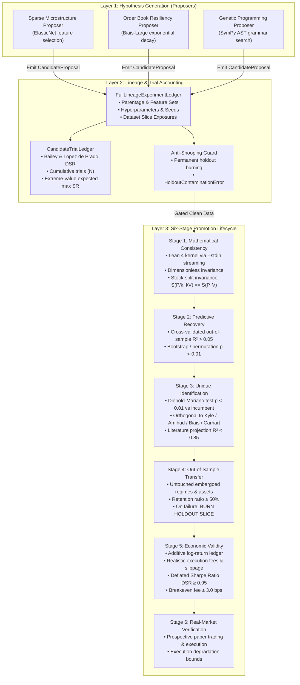

# APEDP-X Architectural Specification: Component Boundaries & Evidence Flow

**Status:** Authoritative  
**Version:** 2.0.0 (Post-Audit Discovery Engine Architecture)  
**Last Updated:** 2026-10-12

---

## 1. Core Architectural Principles

1. **Strict Separation of Proposer and Referee:** Proposers generate hypotheses; referees adjudicate them. Proposers have zero access to confirmation holdout sets, promotion state, or trial ledgers.
2. **Non-Fungibility of Verification Stages:** Mathematical consistency (Lean 4) does not imply empirical predictive power; predictive power does not imply unique mechanism identification; in-sample backtest Sharpe does not imply out-of-sample economic validity.
3. **Irreversible Holdout Burning:** Out-of-sample confirmation holdouts are consumable resources. If a candidate fails on a holdout slice, that slice is permanently burned for all descendant and replacement hypotheses.
4. **Canonical, Immutable Preregistered Specifications:** Preregistered constants are stored in versioned JSON specifications guarded by SHA-256 hashes. Runtime code imports from this single source of truth; tests enforce zero drift.
5. **Declarative Metadata Is Not Evidence:** Fields such as `CandidateProposal.declared_scale_invariant` or `declared_nominal_dependencies` express proposer intent only. As of the v1.4 frozen record no gate, referee, or ledger stage consumes them, and they may never be cited as verified properties of a candidate. Enforcement would require a canonical preregistered spec change (principle 4).

---

## 2. Component Boundaries & Pipeline Topology

---

## 3. Data Firewalls & Holdout Burning Mechanics

### 3.1 The Failure Mode: Iterative Snooping
In typical quantitative research, when a model fails an out-of-sample test, the researcher tweaks features or parameters and tests a new version against the same out-of-sample set. Through repeated iterations, information from the holdout leaks into the candidate search space, turning the holdout into an in-sample training set.

### 3.2 The APEDP-X Solution: Permanent Holdout Burning
To prevent holdout contamination:
1. Every candidate registers the exact `(dataset_id, slice_identifier)` tuples it inspects during development via `FullLineageExperimentLedger.record_data_exposure(..., role=DatasetRole.CONFIRMATION_HOLDOUT)`.
2. When evaluating Stage 4 (`OUT_OF_SAMPLE_TRANSFER`), the candidate is evaluated on a designated confirmation holdout slice.
3. A slice is permanently burned in either of two ways (there is no public `burn_holdout_slice` method):
   - `record_data_exposure(..., role=DatasetRole.CONFIRMATION_HOLDOUT, outcome_status="FAILED")` burns `(dataset_id, slice_identifier)` immediately; or
   - `update_lifecycle_state(...)` transitions the candidate into a terminal failure state (`CONFIRMATION_REJECTED`, `ECONOMIC_EVALUATION_FAILED`, `CALIBRATION_FAILED`, `PRE_SCREEN_REJECTED`, `UNRESOLVED`), which burns every confirmation holdout slice that candidate inspected.
4. Any future `record_data_exposure` against a burned slice triggers `HoldoutContaminationError`, failing closed immediately.

---

## 4. Canonical Specification & Configuration Integrity

Preregistered settings cannot be scattered as independent literals across code and documentation. 

- **Canonical Specification:** Stored at `specifications/canonical_preregistered_spec_v1.json`.
- **Runtime Guard:** `apedp_dyn.conf.canonical_spec` computes the SHA-256 hash of the JSON file upon import. If the hash does not match `a6d026f303a77cbb2f1dd5f8a74c394dd09f8139d811a9bfe4142c82063f6d47`, import halts with `SpecificationIntegrityError`.
- **Consumption:**
  - `canonical_ledger.py` consumes `TACTICAL_ACTIVE_MIN` (5%) and `TACTICAL_ACTIVE_MAX` (90%), `CONTINUOUS_FACTOR_ACTIVE_MIN` (85%), `TAIL_RISK_MIN_EVENTS` (30).
  - `trial_ledger.py` consumes `DSR_THRESHOLD`.
  - `novelty_adjudication.py` consumes `DIEBOLD_MARIANO_P_VALUE_THRESHOLD` and `MAX_LITERATURE_R2`.
  - `promotion_lifecycle.py` consumes stage thresholds.
  - `calibrated_benchmark_suite.py` consumes `REFEREE_MAX_FPR`, `REFEREE_MIN_CAR`, `REFEREE_MIN_VRR`.
- **Automated Verification:** `tests/test_documentation_and_spec_integrity.py` executes in CI to verify that runtime constants, test assertions, and documentation strings remain 100% in sync.

### 4.1 Frozen Benchmark Generations (Historical Duality)
Earlier scientific generations were sealed as immutable benchmark records rather than edited in place. These are **historical artifacts**, not live thresholds, and are hash-verified by tests:

- `apedp_dyn/sandbox/APEDPX_FROZEN_v1.json` — original sealed generation.
- `apedp_dyn/sandbox/APEDPX_FROZEN_v1_1.json` — first revision.
- `apedp_dyn/sandbox/APEDPX_FROZEN_v1_2.json` — second revision.
- `apedp_dyn/sandbox/APEDPX_FROZEN_v1_6.json` — current sealed generation (the one consumed by `blind_benchmark.py` via `FROZEN_RECORD`; supersedes v1_5 after the deep-forensic audit remediation in `ui/server.py`, with blind outcomes unchanged).
- `apedp_dyn/sandbox/APEDPX_FROZEN_v1_4.json`, `APEDPX_FROZEN_v1_3.json`, `APEDPX_FROZEN_v1_2.json`, `APEDPX_FROZEN_v1_1.json`, `APEDPX_FROZEN_v1.json` — superseded generations retained as immutable historical records.
- `apedp_dyn/sandbox/governance_manifest.json` — manifest enumerating the sealed artifacts.

The frozen generations intentionally carry **different threshold key sets** from the canonical live spec (e.g. `RESID_RHO_FLAG`, `SOLE_SURVIVOR_GAMMA`, `bootstrap_seed`). Do not "synchronize" them by editing: the canonical live thresholds are only those in `specifications/canonical_preregistered_spec_v1.json`.

### 4.2 Repository Path Policy
Runtime paths must resolve relative to the repository root or through environment variables; no absolute paths tied to a specific user's home directory may appear in runtime source, scripts, or the live documentation index:

- Path resolution lives in `apedp_dyn/conf/paths.py`: `repo_root()` (`APEDP_REPO_ROOT`), `lean_root()` (`APEDP_LEAN_ROOT`), and `artifact_dir()` (`APEDP_ARTIFACT_DIR`), each with a repo-relative fallback.
- Lean bridge modules resolve the toolchain/output root via the `APEDP_LEAN_ROOT` environment variable, never a hardcoded `/home/<user>/...` prefix.
- New scripts and tests must derive paths from `Path(__file__)`, `tempfile`, or the `APEDP_REPO_ROOT` environment variable.
- The live index (`docs/DOCUMENTATION.md`) uses repository-relative links, validated by `tests/test_documentation_and_spec_integrity.py::test_documentation_links_exist_on_disk`. Archived historical result/specification documents retain their original absolute `file://` provenance URIs and are treated as immutable records rather than live navigation.
