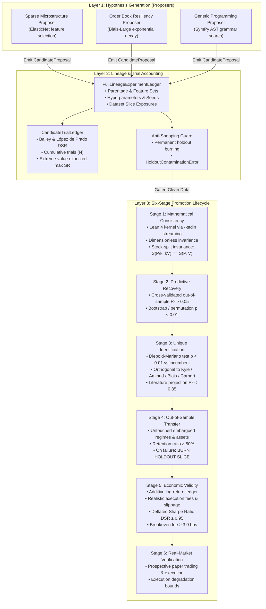

# APEDP-X Architectural Specification: Component Boundaries & Evidence Flow

**Status:** Authoritative  
**Version:** 2.0.0 (Post-Audit Discovery Engine Architecture)  
**Last Updated:** 2026-10-12

---

## 1. Core Architectural Principles

1. **Strict Separation of Proposer and Referee:** Proposers generate hypotheses; referees adjudicate them. Proposers have zero access to confirmation holdout sets, promotion state, or trial ledgers.
2. **Non-Fungibility of Verification Stages:** Mathematical consistency (Lean 4) does not imply empirical predictive power; predictive power does not imply unique mechanism identification; in-sample backtest Sharpe does not imply out-of-sample economic validity.
3. **Irreversible Holdout Burning:** Out-of-sample confirmation holdouts are consumable resources. If a candidate fails on a holdout slice, that slice is permanently burned for all descendant and replacement hypotheses.
4. **Canonical, Immutable Preregistered Specifications:** Preregistered constants are stored in versioned JSON specifications guarded by SHA-256 hashes. Runtime code imports from this single source of truth; tests enforce zero drift.

---

## 2. Component Boundaries & Pipeline Topology

---

## 3. Data Firewalls & Holdout Burning Mechanics

### 3.1 The Failure Mode: Iterative Snooping
In typical quantitative research, when a model fails an out-of-sample test, the researcher tweaks features or parameters and tests a new version against the same out-of-sample set. Through repeated iterations, information from the holdout leaks into the candidate search space, turning the holdout into an in-sample training set.

### 3.2 The APEDP-X Solution: Permanent Holdout Burning
To prevent holdout contamination:
1. Every candidate registers the exact `(dataset_id, slice_id)` tuples it inspects during development.
2. When evaluating Stage 4 (`OUT_OF_SAMPLE_TRANSFER`), the candidate is evaluated on a designated confirmation holdout slice.
3. If the candidate fails Stage 4, `FullLineageExperimentLedger.burn_holdout_slice(dataset_id, slice_id, failed_candidate_id)` permanently blacklists that slice.
4. Any future proposal that attempts to evaluate against a burned slice triggers `HoldoutContaminationError`, failing closed immediately.

---

## 4. Canonical Specification & Configuration Integrity

Preregistered settings cannot be scattered as independent literals across code and documentation. 

- **Canonical Specification:** Stored at `specifications/canonical_preregistered_spec_v1.json`.
- **Runtime Guard:** `apedp_dyn.conf.canonical_spec` computes the SHA-256 hash of the JSON file upon import. If the hash does not match `a6d026f303a77cbb2f1dd5f8a74c394dd09f8139d811a9bfe4142c82063f6d47`, import halts with `SpecificationIntegrityError`.
- **Consumption:**
  - `canonical_ledger.py` consumes `TACTICAL_ACTIVE_MIN` (5%) and `TACTICAL_ACTIVE_MAX` (90%), `CONTINUOUS_FACTOR_ACTIVE_MIN` (85%), `TAIL_RISK_MIN_EVENTS` (30).
  - `trial_ledger.py` consumes `DSR_THRESHOLD`.
  - `novelty_adjudication.py` consumes `DIEBOLD_MARIANO_P_VALUE_THRESHOLD` and `MAX_LITERATURE_R2`.
  - `promotion_lifecycle.py` consumes stage thresholds.
  - `calibrated_benchmark_suite.py` consumes `REFEREE_MAX_FPR`, `REFEREE_MIN_CAR`, `REFEREE_MIN_VRR`.
- **Automated Verification:** `tests/test_documentation_and_spec_integrity.py` executes in CI to verify that runtime constants, test assertions, and documentation strings remain 100% in sync.
