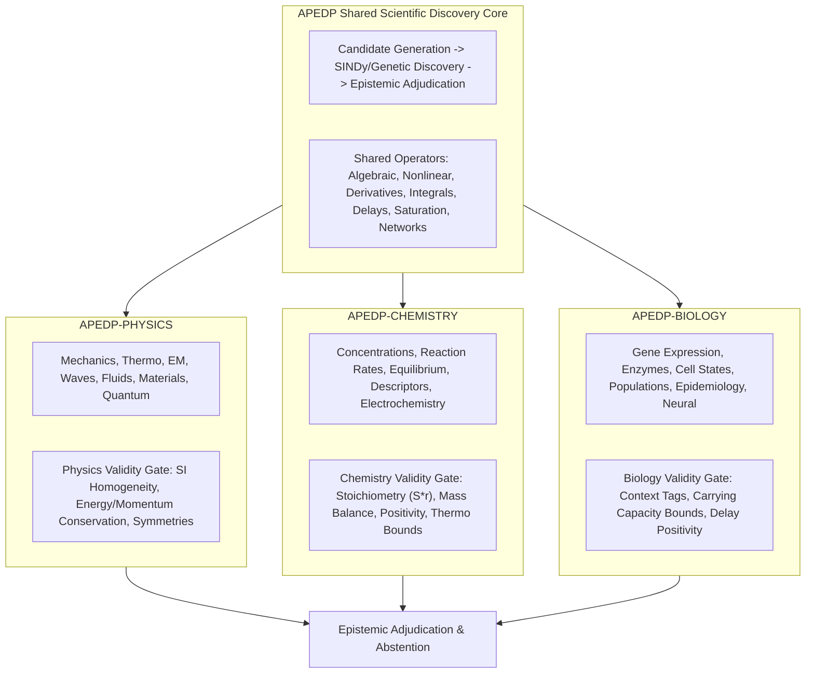

# APEDP Scientific Grammar Space: Physics, Chemistry, and Biology Specification

**Module Implementation:** [`apedp_dyn/grammar/scientific_grammar_catalog.py`](file:///home/psalmprax/ALL_PROJECTS/science/apedp_dyn/grammar/scientific_grammar_catalog.py)  
**Package Integration:** [`apedp_dyn/grammar/__init__.py`](file:///home/psalmprax/ALL_PROJECTS/science/apedp_dyn/grammar/__init__.py)  
**Test Suite:** [`tests/test_dyn_scientific_grammar_catalog.py`](file:///home/psalmprax/ALL_PROJECTS/science/tests/test_dyn_scientific_grammar_catalog.py) (44/44 passing across all suites)  
**Specification Reference:** APEDP Scientific Grammar Space (§§1–7)

---

## 1. Executive Summary & Cross-Domain Scientific Architecture

APEDP extends its causal hypothesis discovery framework beyond market time-series into three core natural science domains: **Physics**, **Chemistry**, and **Biology**.

While the epistemic discovery engine remains unified (causal data, candidate generation, uncertainty quantification, stability testing, rival rejection, abstention), **the validity constraints differ fundamentally by scientific discipline**:
* **Physics:** Governed by SI dimensional homogeneity, conservation laws (energy, momentum), coordinate invariance, and symmetries.
* **Chemistry:** Governed by reaction networks, stoichiometric conservation ($\dot{c} = S r$), atom/charge balance, non-negativity of concentrations, and thermodynamic boundaries ($\Delta G \le 0$).
* **Biology:** Governed by interacting networks, feedback loops, bounded carrying capacities, time delays, and mandatory experimental context tags (organism, cell type, assay conditions).



---

## 2. Domain Packages & Variable Catalogues

### 2.1. APEDP-PHYSICS (`ScientificDomain.PHYSICS`)
* **Mechanics & Motion:** `POSITION_X`, `POSITION_Y`, `POSITION_Z`, `DISTANCE`, `DISPLACEMENT`, `ANGLE`, `AREA`, `VOLUME`, `VELOCITY`, `SPEED`, `ACCELERATION`, `JERK`, `ANGULAR_VELOCITY`, `ANGULAR_ACCELERATION`.
* **Mass & Inertia:** `MASS`, `DENSITY`, `MOMENT_OF_INERTIA`.
* **Force & Momentum:** `FORCE`, `TORQUE`, `LINEAR_MOMENTUM`, `ANGULAR_MOMENTUM`, `IMPULSE`.
* **Energy & Work:** `KINETIC_ENERGY`, `POTENTIAL_ENERGY`, `WORK`, `POWER`, `DISSIPATION_RATE`.
* **Contact & Deformation:** `FRICTION_COEFFICIENT`, `CONTACT_FORCE`, `STRAIN`, `STRESS`.
* **Thermodynamics & Statistical Physics:** `TEMPERATURE`, `PRESSURE`, `INTERNAL_ENERGY`, `ENTHALPY`, `ENTROPY`, `HELMHOLTZ_FREE_ENERGY`, `GIBBS_FREE_ENERGY`, `HEAT_CAPACITY`, `THERMAL_CONDUCTIVITY`, `HEAT_FLUX`, `PARTICLE_NUMBER`, `NUMBER_DENSITY`, `CHEMICAL_POTENTIAL`, `RELAXATION_TIME`.
* **Electricity & Magnetism:** `ELECTRIC_CHARGE`, `CURRENT`, `VOLTAGE`, `RESISTANCE`, `CAPACITANCE`, `INDUCTANCE`, `ELECTRIC_FIELD`, `MAGNETIC_FIELD`, `MAGNETIC_FLUX`, `ELECTRIC_DISPLACEMENT`, `MAGNETIC_VECTOR_POTENTIAL`, `PERMITTIVITY`, `PERMEABILITY`.
* **Circuits & Oscillators:** `INDUCTOR_CURRENT`, `IMPEDANCE`, `MEMRISTANCE`.
* **Waves & Oscillations:** `AMPLITUDE`, `FREQUENCY`, `ANGULAR_FREQUENCY`, `WAVELENGTH`, `WAVE_SPEED`, `DAMPING_COEFFICIENT`, `QUALITY_FACTOR`.
* **Fluids & Transport:** `FLUID_DENSITY`, `PRESSURE_GRADIENT`, `VISCOSITY`, `KINEMATIC_VISCOSITY`, `REYNOLDS_NUMBER`, `PECLET_NUMBER`, `DIFFUSION_COEFFICIENT`, `DRAG_COEFFICIENT`, `VORTICITY`, `STREAM_FUNCTION`, `MACH_NUMBER`, `RAYLEIGH_NUMBER`, `FROUDE_NUMBER`, `KNUDSEN_NUMBER`, `SHEAR_RATE`.
* **Quantum & Modern Physics:** `PLANCK_CONSTANT`, `PROBABILITY_DENSITY`, `SPIN`, `HAMILTONIAN`.

### 2.2. APEDP-ASTROPHYSICS (`ScientificDomain.ASTROPHYSICS`)
* **Gravitation & Orbital Mechanics:** `GRAVITATIONAL_POTENTIAL`, `ECCENTRICITY`, `SEMI_MAJOR_AXIS`, `ORBITAL_PERIOD`, `LUMINOSITY`.
* **Cosmology:** `COSMOLOGICAL_SCALE_FACTOR`, `HUBBLE_PARAMETER`, `REDSHIFT`.

### 2.3. APEDP-CHEMISTRY (`ScientificDomain.CHEMISTRY`)
* **Composition & Concentration:** `SPECIES_CONCENTRATION`, `MOLE_FRACTION`, `MASS_FRACTION`, `ACTIVITY`, `ACTIVITY_COEFFICIENT`, `PARTIAL_PRESSURE`, `IONIC_STRENGTH`, `PH`.
* **Reaction State & Progress:** `REACTANT_CONCENTRATION`, `PRODUCT_CONCENTRATION`, `REACTION_EXTENT`, `CONVERSION`, `YIELD`.
* **Reaction Rates & Kinetics:** `REACTION_RATE`, `FORMATION_RATE`, `CONSUMPTION_RATE`, `RATE_CONSTANT`, `ACTIVATION_ENERGY`, `ARRHENIUS_PRE_EXPONENTIAL`, `REACTION_ORDER`, `HALF_LIFE`, `STOICHIOMETRIC_COEFFICIENT`.
* **Thermodynamics & Equilibrium:** `EQUILIBRIUM_CONSTANT`, `REACTION_QUOTIENT`, `STANDARD_REACTION_GIBBS_ENERGY`, `STANDARD_REACTION_ENTHALPY`, `STANDARD_REACTION_ENTROPY`, `SOLUBILITY`.
* **Solution Chemistry:** `ACID_DISSOCIATION_CONSTANT`, `BASE_DISSOCIATION_CONSTANT`, `SOLUBILITY_PRODUCT`.
* **Electrochemistry & Catalysis:** `ELECTRODE_POTENTIAL`, `OVERPOTENTIAL`, `FARADAIC_EFFICIENCY`, `FARADAY_CONSTANT`, `NERNST_POTENTIAL`, `TRANSFER_COEFFICIENT`, `CATALYST_LOADING`, `TURNOVER_FREQUENCY`.
* **Molecular Descriptors:** `MOLECULAR_WEIGHT`, `ELECTRONEGATIVITY`.

### 2.4. APEDP-BIOLOGY (`ScientificDomain.BIOLOGY`)
* **Molecular & Gene Regulation:** `GENE_EXPRESSION`, `MRNA_ABUNDANCE`, `TRANSCRIPTION_RATE`, `RNA_DEGRADATION_RATE`, `PROTEIN_ABUNDANCE`, `TRANSLATION_RATE`, `TRANSCRIPTION_FACTOR_ABUNDANCE`, `BINDING_AFFINITY`, `HILL_COEFFICIENT`, `PROMOTER_ACTIVITY`, `PROTEIN_DEGRADATION_RATE`.
* **Enzyme Kinetics & Biochemistry:** `ENZYME_CONCENTRATION`, `SUBSTRATE_CONCENTRATION`, `MICHAELIS_CONSTANT`, `TURNOVER_NUMBER_KCAT`, `INHIBITOR_CONCENTRATION`.
* **Cell Biology & Bioenergetics:** `CELL_COUNT`, `CELL_DENSITY`, `CELL_GROWTH_RATE`, `APOPTOSIS_RATE`, `ATP_CONCENTRATION`, `ENERGY_CHARGE`, `BIOMASS`, `METABOLIC_FLUX`.
* **Physiology & Organisms:** `HEART_RATE`, `BLOOD_PRESSURE`, `BODY_TEMPERATURE`.
* **Epidemiology Compartments (SEIR):** `SUSCEPTIBLE_POPULATION`, `EXPOSED_POPULATION`, `INFECTIOUS_POPULATION`, `RECOVERED_POPULATION`, `BASIC_REPRODUCTION_NUMBER`, `PATHOGEN_LOAD`, `TRANSMISSION_RATE`, `RECOVERY_RATE`.
* **Ecology & Populations:** `POPULATION_SIZE`, `BIRTH_RATE`, `DEATH_RATE`, `PREDATOR_DENSITY`, `PREY_DENSITY`, `CARRYING_CAPACITY`, `SPECIES_INTERACTION_STRENGTH`.
* **Neuroscience & Electrophysiology:** `MEMBRANE_POTENTIAL`, `SPIKE_RATE`, `SYNAPTIC_STRENGTH`, `ACTION_POTENTIAL_THRESHOLD`, `REFRACTORY_PERIOD`, `IONIC_CONDUCTANCE`, `REVERSAL_POTENTIAL`.

### 2.5. APEDP-MATHEMATICS (`ScientificDomain.MATHEMATICS`)
* **Dynamical Systems & Chaos:** `BIFURCATION_PARAMETER`, `LYAPUNOV_EXPONENT`, `ORDER_PARAMETER`, `PHASE_SPACE_COORDINATE`, `TIME_DELAY`.

---

## 3. Shared Scientific Operator Library

Implemented in [`apedp_dyn/grammar/scientific_grammar_catalog.py`](file:///home/psalmprax/ALL_PROJECTS/science/apedp_dyn/grammar/scientific_grammar_catalog.py):

| Operator | Mathematical Definition | Purpose & Domain Application |
| :--- | :--- | :--- |
| `op_michaelis_menten(s, Vmax, Km)` | $v = \frac{V_{\max} [S]}{K_m + [S]}$ | Enzyme saturation rate laws (Biochemistry, Pharmacology) |
| `op_hill_activation(x, K, n)` | $f(x) = \frac{x^n}{K^n + x^n}$ | Sigmoidal gene activation & cooperative binding (Molecular Biology) |
| `op_hill_repression(x, K, n)` | $f(x) = \frac{K^n}{K^n + x^n}$ | Transcriptional repression & negative feedback |
| `op_temporal_derivative(x, dt)` | $\frac{dx}{dt} \approx \frac{x_t - x_{t-1}}{\Delta t}$ | Causal time derivative for ODE rate equations |
| `op_temporal_integral(x, dt)` | $\int_0^t x(s) \, ds$ | Causal trapezoidal accumulation |
| `op_delay(x, tau)` | $x(t - \tau)$ | Time-delayed response (Cell cycle, Immune latency) |
| `op_threshold_activation(x, theta)` | $\mathbb{I}(x > \theta)$ | Switch and threshold activation |
| `op_lotka_volterra_step(prey, pred, ...)` | $\dot{N}_1 = \alpha N_1 - \beta N_1 N_2$, $\dot{N}_2 = \delta N_1 N_2 - \gamma N_2$ | Ecological population cycle update |

---

## 4. Specialized Domain Validity Gates

### 4.1. Physics Validity Gate (`PhysicsValidityGate`)
1. **Dimensional Homogeneity:** Verifies that both sides of proposed equations share identical 7-component SI dimension exponents:
   $$(M, L, T, \Theta, N, I, J)$$
   Rejects non-physical additions (e.g. force + energy).
2. **Energy Conservation:** Verifies that in conservative mechanical systems, total energy $E = T + V$ satisfies $\Delta E / \bar{E} \le \text{tol}$.

### 4.2. Chemistry Validity Gate (`ChemistryValidityGate`)
1. **Concentration Positivity:** Enforces $c_i(t) \ge 0$ for all physical chemical species.
2. **Stoichiometric Mass Balance:** Enforces consistency with the reaction network stoichiometric matrix $S$:
   $$\frac{dc}{dt} = S \cdot r(c, T)$$
   Rejects equations where net production violates mass balance.

### 4.3. Biology Validity Gate (`BiologyValidityGate`)
1. **Biological Context Requirement:** Rejects variable instantiations lacking mandatory experimental context tags (e.g. `GENE_EXPRESSION` requires `organism`, `cell_type`, `assay`).
2. **Population Bounds:** Enforces $N(t) \ge 0$ and suppresses unphysical population explosions exceeding carrying capacity limits ($N \le 2 K$).

---

## 5. Machine-Readable Schema & Provenance

Every scientific variable is instantiated using the standardized dataclass:

```python
@dataclass(frozen=True)
class ScientificVariableSpec:
    variable_id: str
    domain: ScientificDomain
    family: str
    kind: ScientificVariableKind = ScientificVariableKind.MEASURED_STATE
    value_type: ValueType = ValueType.SCALAR
    unit: str = "dimensionless"
    dimensions: tuple[int, int, int, int, int, int, int] = (0, 0, 0, 0, 0, 0, 0)
    source: str = "measurement_or_derived"
    availability: str = "timestamped"
    uncertainty: str = "required"
    entity: str | None = None
    context_required: tuple[str, ...] = ()
    constraints: dict[str, Any] = field(default_factory=dict)
```

The catalog is serializable to JSON via `ScientificGrammarCatalog().to_json()` and exports a deterministic cryptographic SHA-256 fingerprint (`compute_catalog_fingerprint()`) guaranteeing benchmark and schema provenance.
