# APEDP Trading Grammar Space: Comprehensive Architecture Specification

**Module Implementation:** [`apedp_dyn/grammar/trading_grammar_catalog.py`](file:///home/psalmprax/ALL_PROJECTS/science/apedp_dyn/grammar/trading_grammar_catalog.py)  
**Re-exported Interface:** [`apedp_dyn/sandbox/grammar_space.py`](file:///home/psalmprax/ALL_PROJECTS/science/apedp_dyn/sandbox/grammar_space.py) & [`apedp_dyn/grammar/__init__.py`](file:///home/psalmprax/ALL_PROJECTS/science/apedp_dyn/grammar/__init__.py)  
**Unit Test Suite:** [`tests/test_dyn_trading_grammar_catalog.py`](file:///home/psalmprax/ALL_PROJECTS/science/tests/test_dyn_trading_grammar_catalog.py) (38/38 passing)  
**Specification Reference:** APEDP Trading Grammar Space Comprehensive Variable Catalogue (§§1–15)

---

## 1. Executive Summary & Architecture Gap Analysis

Prior to this expansion, APEDP's quantitative trading layer operated on two disparate, semi-structured representations:
1. **Legacy Volatility Grammar (`apedp_dyn/sandbox/grammar_space.py`):** A minimal vocabulary limited to primitives $r_t, V_t, \text{OFI}_t$, basic unary/binary operations, and early volatility models ($H_P, H_{RV}, H_A$).
2. **Flat Multi-Asset Array (`apedp_dyn/sandbox/multi_asset_signals_sandbox.py`):** A fixed, flat vector of 26 signals (19 primitives + 7 non-linear interaction terms) lacking formal layer typing, lookback declarations, causal contracts, or modular expansion capabilities.

The comprehensive variable catalogue transforms this setup into a **5-layer hierarchical, strongly typed, and machine-readable trading grammar engine**.

```mermaid
flowchart TD
    subgraph Layer0 ["Layer 0: Raw Market Observations"]
        L0_OHLCV["OHLCV Candles (Open, High, Low, Close, Volume, Taker Buy)"]
        L0_Trades["Trade Ticks (Price, Size, Side, Intensity)"]
        L0_Book["Order Book (L1..Ln Depth, Microprice, Spreads)"]
        L0_Deriv["Derivatives (Funding, OI, Basis, Liquidations)"]
        L0_Cal["Calendar & Sessions (Hour, Day, Funding Countdown)"]
    end

    subgraph Layer1 ["Layer 1: Primitive Transformations"]
        L1_Ret["Multi-Horizon Returns (RET_k, LOGRET_k, Open-to-Close)"]
        L1_Candle["Candle Shape (True Range, Body/Range, Close Location)"]
        L1_Dist["Reference Distance (Dist to SMA, EMA, Donchian, VWAP)"]
    end

    subgraph Layer2 ["Layer 2: Technical & Statistical Feature Families"]
        L2_Trend["Trend & MA (EMA Spread, Slope, MACD, ADX, Efficiency)"]
        L2_Mom["Momentum & Oscillators (RSI, ROC, Stochastic %K)"]
        L2_Vol["Volatility (ATR, NATR, Realized Vol, Parkinson, Squeeze)"]
        L2_Flow["Order Flow (Taker Imbalance, Signed Vol Momentum, CMF)"]
        L2_Cross["Cross-Asset (Beta to BTC, Correlation, Universe Rank)"]
    end

    subgraph Layer3 ["Layer 3: Candidate Equations"]
        L3_Eq["Symbolic Combinations (Linear, Multiplicative, Gated Terms)"]
    end

    subgraph Layer4 ["Layer 4: Trading Policy & Risk Control"]
        L4_Policy["Stateful Execution (Sign, Hysteresis, Deadband, Turnover Penalty)"]
        L4_Risk["Portfolio Risk (Drawdown Limits, Risk Parity, Master Sizing)"]
    end

    Layer0 --> Layer1
    Layer1 --> Layer2
    Layer2 --> Layer3
    Layer3 --> Layer4
```



---

## 2. The 5-Layer Architectural Hierarchy

### Layer 0: Raw Market Variables
Observable market inputs provided by exchange feeds. Input availability is explicitly tracked:
- **OHLCV Candles:** `OPEN`, `HIGH`, `LOW`, `CLOSE`, `VOLUME_BASE`, `VOLUME_QUOTE`, `TRADE_COUNT`, `TAKER_BUY_BASE`, `TAKER_BUY_QUOTE`, `VWAP_BAR`.
- **Individual Trades:** `TRADE_PRICE`, `TRADE_SIZE`, `AGGRESSOR_SIDE`, `LARGE_TRADE_FLAG`, `TRADE_INTENSITY`.
- **Order Book & Spreads:** `BID_PRICE_L1`, `ASK_PRICE_L1`, `BID_SIZE_L1`, `ASK_SIZE_L1`, `MICROPRICE`, `SPREAD_BPS`, `ROLL_SPREAD`.
- **Derivatives & Perpetuals:** `FUNDING_RATE`, `OPEN_INTEREST`, `OPEN_INTEREST_CHANGE`, `PERPETUAL_BASIS`, `LONG_SHORT_RATIO`, `LIQUIDATION_VOLUME`.
- **Options & Volatility Indices:** `IMPLIED_VOLATILITY_ATM`, `PUT_CALL_RATIO_VOLUME`, `DVOL`.
- **Calendar & Session:** `HOUR_OF_DAY`, `DAY_OF_WEEK`, `IS_WEEKEND`, `MINUTES_TO_FUNDING`.

### Layer 1: Primitive Transformations
Deterministic transforms computed from Layer 0 without parameter fitting:
- **Returns:** Multi-horizon returns `RET_1`, `RET_2`, `RET_4`, `RET_8`, `RET_16`, `LOGRET_1`, `OPEN_TO_CLOSE`, `RETURN_ACCELERATION`.
- **Candle Shape & Range:** `TRUE_RANGE`, `BODY_TO_RANGE`, `UPPER_WICK_TO_RANGE`, `LOWER_WICK_TO_RANGE`, `CLOSE_LOCATION`.
- **Distance from Reference Prices:** `DIST_TO_SMA`, `DIST_TO_EMA`, `DIST_TO_DONCHIAN_HIGH`, `DIST_TO_DONCHIAN_LOW`, `VWAP_DISPLACEMENT`.

### Layer 2: Feature Families
Higher-order technical and statistical estimators across core domains:
1. **Trend & Moving Averages:** `EMA_SPREAD`, `EMA_SLOPE`, `MACD`, `ADX`, `TREND_EFFICIENCY`, `OU_MEAN_REVERSION`, `SPREAD_HALF_LIFE`.
2. **Momentum & Oscillators:** `RSI`, `ROC`, `STOCH_K`.
3. **Volatility & Distributional Risk:** `ATR`, `NATR`, `REALIZED_VOL`, `DOWNSIDE_VOL`, `PARKINSON_VOL`, `GARMAN_KLASS_VOL`, `BB_WIDTH`, `BB_PERCENT_B`, `KELTNER_WIDTH`, `SQUEEZE_STATE`, `BREAKOUT_STRENGTH`, `ROLLING_SKEWNESS`, `ROLLING_KURTOSIS`, `REALIZED_SEMIVARIANCE`, `VALUE_AT_RISK`, `EXPECTED_SHORTFALL`.
4. **Volume & Activity:** `LOG_VOLUME`, `RELATIVE_VOLUME`, `VOLUME_ZSCORE`, `OBV_MOM`, `CMF`, `MFI`, `AMIHUD_ILLIQUIDITY`.
5. **Microstructure & Flow:** `TAKER_IMBALANCE`, `ORDER_FLOW_IMBALANCE`, `SIGNED_VOLUME_MOMENTUM`, `DEPTH_IMBALANCE`, `MICROPRICE_DISPLACEMENT`, `KYLE_LAMBDA`.
6. **Cross-Asset Context & Cointegration:** `BTC_RETURN`, `BTC_REALIZED_VOL`, `ROLLING_BETA_TO_BTC`, `CORRELATION_TO_BTC`, `CROSS_SECTIONAL_RETURN_RANK`, `PERCENT_ABOVE_MA`, `COINTEGRATION_RESIDUAL`, `KALMAN_HEDGE_RATIO`.
7. **Canonical Sandbox Feature Registry ($X_0 \dots X_{18}$):** `H-OFI`, `H-CVD`, `H-P`, `H-ASYM`, `H-NATR`, `H-SQUEEZE`, `H-MACD`, `H-EMA_CROSS`, `H-RSI`, `H-BB`, `H-MOM`, `H-STOCH`, `H-RV`, `H-A`, `H-LOG`, `H-MFI`, `H-OBV_MOM`, `H-HURST`, `H-CROSS_MOM`.

### Layer 3: Candidate Equations & Interaction Terms
Symbolic compositions and pre-registered nonlinear interaction terms ($X_{19} \dots X_{26}$):
- **Empirical Nonlinear Interactions:**
  - `NL_VOL_GATED_MOM` ($X_{19} = X_{10} \times X_{12}$)
  - `NL_SQUEEZE_TREND` ($X_{20} = X_6 \times X_5$)
  - `NL_RISK_ADJ_MOM` ($X_{21} = X_{10} / X_4$)
  - `NL_OFI_REV` ($X_{22} = X_0 \times (0.5 - X_8)$)
  - `NL_HURST_ADAPT` ($X_{23} = X_{10} \times (X_{17} - 0.5)$)
  - `NL_TAKER_MOM` ($X_{24} = X_1 \times X_{10}$)
  - `NL_MASTER_SNR` ($X_{25} = X_{10} / (X_3^2 + \epsilon)$)
  - `PRODUCT_H_BB_TAKER` ($X_{26} = X_9 \times X_1$)

### Layer 4: Position, Risk & Trading Policy
Converts predictor scores $S_{i,t}$ into executable target positions $p_{i,t}$ and tracks state:
- **Decision Operators:** `SIGN`, `DEADBAND(S, \tau)`, `HYSTERESIS(S, p_{t-1}; \theta_{\text{in}}, \theta_{\text{out}})`, `TURNOVER_PENALTY(S, p_{t-1}, \lambda)`.
- **State & Risk Variables:** `CURRENT_POSITION`, `UNREALIZED_PNL`, `PORTFOLIO_DRAWDOWN`, `TURNOVER_COST`, `ESTIMATED_SLIPPAGE`, `TRADE_HOLDING_TIME`, `DYNAMIC_TRAILING_STOP`, `OPTIMAL_KELLY_FRACTION`, `LEVERAGE_RATIO`, `MARGIN_UTILIZATION_PCT`.

---

## 3. Mathematical Operator Library (Spec §10)

All operators are causally strictly enforced and equipped with explicit domain protections:

| Category | Operator | Mathematical Form | Domain Safety & Causal Rule |
| :--- | :--- | :--- | :--- |
| **Arithmetic** | `safe_div(x, y)` | $x / \text{sign}(y)\max(\|y\|, \epsilon)$ | Explicit denominator floor $\epsilon=10^{-12}$; zero division prohibited |
| | `safe_log(x)` | $\ln(\max(x, \epsilon))$ | Enforces strictly positive argument $x \ge 10^{-12}$ |
| | `safe_sqrt(x)` | $\sqrt{\max(x, 0)}$ | Enforces non-negative radicand $x \ge 0$ |
| | `exp_clamp(x)` | $\exp(\text{clip}(x, -20, 20))$ | Clamps exponent to $[-20, +20]$ avoiding float overflow |
| | `op_tanh(x)` | $\tanh(x)$ | Natural bounded mapping in $[-1, 1]$ |
| **Rolling** | `roll_mean(x, n)` | $\frac{1}{n} \sum_{i=0}^{n-1} x_{t-i}$ | Causal trailing window; NaN until $n$ observations |
| | `roll_std(x, n)` | $\sqrt{\frac{1}{n-1} \sum (x - \bar{x})^2}$ | Causal trailing sample standard deviation |
| | `roll_slope(x, n)` | $\text{OLS}(x, t)$ slope | Causal regression slope against time index |
| | `ewma(x, span)` | $\alpha x_t + (1-\alpha) \text{ewma}_{t-1}$ | Exponentially weighted moving average |
| | `roll_beta(x, b, n)` | $\text{Cov}(x, b) / \text{Var}(b)$ | Rolling asset beta to benchmark |
| **Temporal** | `op_lag(x, k)` | $x_{t-k}$ | Temporal shift; forward shifts strictly banned in predictors |
| | `op_pct_change(x, k)` | $(x_t - x_{t-k}) / x_{t-k}$ | Safe percentage return |
| | `op_acceleration(x, k)` | $\Delta^2 x_t = (x_t - x_{t-k}) - (x_{t-k} - x_{t-2k})$ | Second temporal difference |
| | `time_since_last_high(x, n)` | $n - 1 - \text{argmax}(x_{t-n+1:t})$ | Bars since rolling high |
| | `consecutive_up_bars(r)` | Count of consecutive $r_t > 0$ | Causal momentum streak length |
| **Normalization** | `causal_zscore(x, w)` | $(x_t - \mu_{\text{exp}}) / \sigma_{\text{exp}}$ | Expanding causal z-score (zero future leakage) |
| | `trailing_rank(x, w)` | $\text{Rank}(x_t \mid x_{t-w+1:t}) / (w-1)$ | Percentile rank in $[0, 1]$ |
| | `cross_sectional_rank(M)` | $\text{Rank}(M_{t, i} \mid M_{t, :}) / (N-1)$ | Cross-asset relative rank at timestamp $t$ |
| | `robust_zscore(x)` | $(x - \text{median}) / (1.4826 \cdot \text{MAD})$ | Outlier-resistant scale score |
| | `winsorize(x, p_lo, p_hi)` | $\text{clip}(x, Q_{lo}, Q_{hi})$ | Truncates extreme tail realizations |
| **Gating** | `op_deadband(S, \tau)` | $\text{sign}(S) \cdot \mathbb{I}(\|S\| \ge \tau)$ | Filters weak signals |
| | `signal_gate(S, mask)` | $S \cdot \text{mask}$ | Conditional signal activation |
| | `regime_gate(S, v, lo, hi)` | $S \cdot \mathbb{I}(lo \le v \le hi)$ | Regime-dependent filtering (e.g. Squeeze / Hurst) |
| | `op_cooldown(p, k)` | Enforces $p_t = 0$ for $k$ bars after exit | Churn and whipsaw suppression |

---

## 4. Target & Outcome Grammar (Spec §11)

Targets are formally segregated from predictive features. Every target explicitly requires future data ($\tau > t$) and declares an objective:

```python
TargetSpec("FWD_RET_1", "Next 1-bar simple return", "Return magnitude", horizon_bars=1)
TargetSpec("FWD_RET_4", "Next 4-bar simple return", "Return magnitude", horizon_bars=4)
TargetSpec("FWD_RET_16", "Next 16-bar simple return", "Return magnitude", horizon_bars=16)
TargetSpec("FWD_DIRECTION_1", "Binary sign of next bar return", "Directional classification", horizon_bars=1)
TargetSpec("FWD_CS_RANK_1", "Cross-sectional return rank in universe", "Cross-sectional selection", horizon_bars=1)
TargetSpec("FWD_REALIZED_VOL_16", "Realized volatility over next 16 bars", "Volatility forecast", horizon_bars=16)
TargetSpec("FWD_MAX_DRAWDOWN_16", "Maximum path drawdown over next 16 bars", "Downside tail risk", horizon_bars=16)
TargetSpec("FWD_TRIPLE_BARRIER_16", "Triple barrier path outcome (+1, -1, 0)", "Barrier hit", horizon_bars=16)
```

### Three Separated Epistemic Levels
1. **Predictive Information:** Does feature $X$ have statistically significant correlation/mutual information with target $Y$?
2. **Structural Support:** Is the relationship stable, parsimonious, and distinct from rival formulations across bootstrap splits?
3. **Trading Utility:** Does a frozen trading policy using $X$ generate superior net returns after realistic fees, slippage, and execution constraints?

---

## 5. Machine-Readable Schema (Spec §14)

Every feature in the registry implements the standardized `FeatureSpec` dataclass:

```python
@dataclass(frozen=True)
class FeatureSpec:
    feature_id: str
    layer: GrammarLayer
    family: FeatureFamily
    description: str
    inputs: tuple[str, ...]
    formula: str
    frequency: str = "bar"
    data_type: DataType = DataType.RATIO
    units: str = "dimensionless"
    lookback: int = 1
    min_history: int = 1
    availability: AvailabilityTiming = AvailabilityTiming.BAR_CLOSE
    normalization: str = "none"
    requires: tuple[str, ...] = ()
    failure_policy: FailurePolicy = FailurePolicy.UNRESOLVED
    causal_contract: bool = True
    domain_constraints: str = "none"
```

The master catalog exports to JSON via `TradingGrammarCatalog().to_json()` and generates a deterministic cryptographic SHA-256 fingerprint (`compute_catalog_fingerprint()`) guaranteeing code and data provenance.

---

## 6. Recommended First-Stage Grammar Extraction (Spec §13)

Implemented directly in `compute_recommended_first_stage_features(df, btc_df, cs_matrix_close)`:
- **Assets & Horizons:** Tailored for 30m–60m crypto trading across BTC, ETH, SOL, BNB, DOGE.
- **Inputs:** Synchronized OHLCV candle feeds + taker buy volume + order flow imbalance.
- **Output:** 42 causally computed indicators covering price returns, candle morphology, trend, oscillators, range volatility (including Parkinson and Garman-Klass), volume activity, order book imbalance, and cross-asset beta to BTC.

---

## 7. Verification and Test Suite

All 38 test suites pass cleanly across mechanical grammar, policy grammar, and the new trading catalog:
```
tests/test_dyn_grammar.py ......................... PASSED (7 tests)
tests/test_dyn_grammar_scope.py ................... PASSED (7 tests)
tests/test_dyn_grammar_space.py ................... PASSED (6 tests)
tests/test_dyn_policy_grammar.py .................. PASSED (6 tests)
tests/test_dyn_crypto_grammar.py .................. PASSED (4 tests)
tests/test_dyn_trading_grammar_catalog.py ......... PASSED (8 tests)
======================== 38 passed in 70.65s ========================
```
