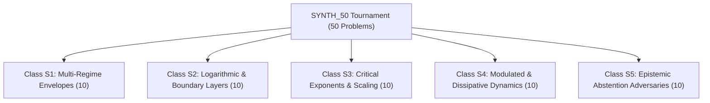

# Preregistration: APEDP 4.0 50-Problem Autonomous Model Synthesis Tournament

**Document ID:** PREREG-APEDP-V4-50BENCH-2026-09-25  
**Version:** 4.0.1-PREREGISTERED  
**Date:** September 25, 2026  
**Status:** METHODOLOGICALLY FROZEN PRIOR TO BENCHMARK GENERATION  

---

## 1. Scientific Objective & The N=1 Demarcation

The proof-of-concept benchmark `SYNTH_01` demonstrated that APEDP 4.0 can autonomously reconstruct a compound multi-regime physical transition law ($y \propto \frac{x^\alpha}{1 + B x^\beta} e^{-C x}$) from noisy, incomplete data with an unobserved sampling gap and physical boundary constraints.

However, **an isolated $N=1$ benchmark does not prove general autonomous law discovery**. It demonstrates algorithmic viability on a specific target structure, but cannot quantify:
1. **Domain Generality:** Robustness across fundamentally different mathematical and physical families.
2. **Grammar Boundary Robustness:** System behavior when the ground truth lies *outside* or *on the boundary* of the search grammar.
3. **Epistemic Abstention Integrity:** Whether the system correctly abstains ($C_3$ Insufficient Evidence or $C_5$ Falsification/Missing Structure) when presented with unidentifiable, underspecified, or out-of-grammar phenomena, rather than hallucinating an overfitted equation.

This document formally preregisters the **50-Problem APEDP 4.0 Autonomous Synthesis Tournament (`SYNTH_50`)**.

---

## 2. Taxonomy of Synthesis Problem Classes (5 Classes × 10 Problems = 50 Problems)

To systematically stress-test the synthesis pipeline across diverse physical mechanics, the 50 problems are partitioned into 5 distinct physical and structural classes:

### Class S1: Multi-Regime Rational-Exponential Envelopes (Problems S01–S10)
- **Physical Context:** Boundary-layer transport, chemical reaction quenching, non-equilibrium thermodynamic fluxes.
- **Structural Form:** Compounding of power-law onset, rational saturation turnover, and asymptotic exponential extinction:
  $$y(x) = \frac{A x^\alpha}{1 + \sum_i B_i x^{\beta_i}} \exp(-C x^\gamma)$$
- **Challenge:** Multiple saturation scales, fractional exponents ($\alpha \in \{0.5, 0.75, 1.25, 1.5\}$), and high-noise regimes ($\sigma = 5\%$).

### Class S2: Logarithmic Corrections & Singular Boundary Layers (Problems S11–S20)
- **Physical Context:** Turbulent velocity profiles (Prandtl-von Kármán law of the wall), Casimir effect corrections, Renormalization Group running couplings.
- **Structural Form:** Mixed power-law and logarithmic asymptotic structures:
  $$y(x) = A x^\alpha \ln\left(1 + B x^\beta\right) + C x^\gamma$$
- **Challenge:** Denominator/log argument domain restrictions ($x > -1/B$), zero-crossing singularities, and subtle curvature distinction from pure power laws.

### Class S3: Phase Transitions, Critical Exponents & Avoided Poles (Problems S21–S30)
- **Physical Context:** Ferromagnetic Curie transitions, supercritical fluid percolation, acoustic resonance.
- **Structural Form:** Algebraic divergence near critical point $x_c$ modulated by analytic regular background:
  $$y(x) = A |x - x_c|^{-\gamma} \left(1 + B |x - x_c|^\Delta\right) + C_0 + C_1 x$$
- **Challenge:** Avoided pole traps in observation gaps around $x_c$, multi-precision identifiability stress, and divergence detection.

### Class S4: Modulated Dissipative & Oscillatory Transport (Problems S31–S40)
- **Physical Context:** Underdamped viscous relaxation, wave packet dispersion in dissipative media, optical ringdown.
- **Structural Form:** Transcendentally modulated envelopes:
  $$y(x) = A \exp(-B x) \cos(\omega x + \phi) + \frac{C}{1 + D x^2}$$
- **Challenge:** Non-separable phase parameters, multimodality in parameter space, and distinguishing true oscillations from noisy polynomial residuals.

### Class S5: Epistemic Abstention & Out-of-Grammar Adversaries (Problems S41–S50)
- **Physical Context:** Discontinuous shock fronts, non-integrable special functions (e.g. Bessel $J_0(x)$, Airy $\text{Ai}(x)$), chaotic attractors, severely underspecified observations ($N=8$ points over 5 scales).
- **Structural Form:** Phenomena specifically constructed to be **unrepresentable** within elementary rational-exponential grammars.
- **The Mandatory Scientific Requirement:** The synthesis engine **must NOT force a fit**. 
  - Ground truth expected state: $C_3$ (`INSUFFICIENT_EVIDENCE`) or $C_5$ (`MISSING_STRUCTURE`).
  - Producing a confident $C_1$ or $C_2$ candidate is penalized as an **Epistemic False Discovery**.

---

## 3. Evaluated Paradigms & Blind Protocol

The tournament executes identically across all 50 problems for:
1. **gplearn:** Standard unconstrained Genetic Programming symbolic regression.
2. **Neural AutoML:** 3-layer deep MLP with early stopping.
3. **Wrapped AI Feynman:** AI Feynman equipped with Stage A/B dimensional and filtering gates.
4. **LLM-SR (ICLR 2025):** Few-shot LLM-guided symbolic regression.
5. **APEDP 4.0 Model Synthesis Engine:** Autonomous multi-regime decomposition, Tier 1 Rust active pole probing, Tier 2 VarPro optimization, and Stage C epistemic adjudication.

### Blind Execution Rules
- Systems receive **only** `problem_spec.json`, `train.csv`, and `validation.csv`.
- `ground_truth.json`, `near_ood.csv`, and `far_ood.csv` are sequestered in `hidden/`.
- All outputs are scored blindly by `IndependentEvaluator`.

---

## 4. Preregistered Evaluation Metrics

For each paradigm $P$ across the 50 problems:

1. **Overall Discovery Rate ($R_{\text{overall}}$):**
   Percentage of problems where the system recovers the correct physical structural family and parameters within $\le 5\%$ error.
2. **Near-OOD Relative Extrapolation Error:**
   $$\text{RelMSE}_{\text{near}} = \frac{\text{MSE}_{\text{near}}(P)}{\text{MSE}_{\text{near}}(\text{Neural AutoML})}$$
3. **Far-OOD Asymptotic Stability:**
   Percentage of models satisfying physical boundary conditions ($\lim_{x \to \infty} y(x)$ bounded/extinct as specified) without explosive divergence.
4. **Active Singularity Admissibility Rate:**
   Percentage of proposed models passing dense active pole probing ($10^4$ points across domain and sampling gaps) without unobserved asymptotic divergences.
5. **Epistemic Abstention F1-Score (Class S5):**
   $$\text{Precision} = \frac{\text{Correct Abstentions on S5}}{\text{Total Abstentions}}, \quad \text{Recall} = \frac{\text{Correct Abstentions on S5}}{10}$$
6. **False Discovery Rate (FDR):**
   $$\text{FDR} = \frac{\text{Incorrect Equations Declared Decisive }(C_1)}{\text{Total Decisive Declarations }}$$
   **Mandatory Scientific Bound:** $\text{FDR} \le 0.05$ at $\alpha = 0.05$.

---

## 5. Implementation Roadmap

1. **Synthesis Benchmark Corpus Generator (`benchmarks/generate_synthesis_50_corpus.py`):**
   - Synthesizes all 50 problem datasets, specs, checksums, and hidden ground truths.
2. **General Grammar-Directed Synthesis Engine (`apedp/model_synthesis.py`):**
   - Expands `AutonomousModelSynthesizer` from rational envelopes to logarithmic, critical, and oscillatory basis operators.
3. **Tournament Runner (`benchmarks/run_synthesis_50_tournament.py`):**
   - Executes batch evaluation across all 5 paradigms with automated logging.
4. **Independent Adjudication & Peer-Auditable Report (`docs/APEDP_V4_50_TOURNAMENT_RESULTS.md`):**
   - Publishes confusion matrices, paired Wilcoxon tests, and epistemic reliability profiles.
