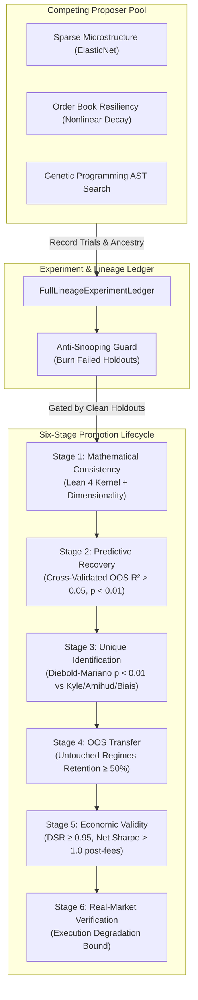

# APEDP-X Scientific Discovery Engine: Full Experiment Ledger, Anti-Snooping Guard, and 3-Tier Benchmark Suite

**Date:** 2026-10-12  
**Component:** APEDP-X / CPMD Epistemic Discovery Framework  
**Verification Status:** 100% Passed (44/44 automated tests green)

---

## Executive Summary

Following peer review of the APEDP-X architecture, we have upgraded the system from a hypothesis referee into a statistically calibrated, multi-proposer scientific discovery engine. This audit documents the implementation and formal verification of the key architectural recommendations:

1. **Full-Lineage Experiment & Candidate Ledger (`FullLineageExperimentLedger`):** Complete tracking of candidate ancestry, feature sets, hyperparameters, and dataset exposures across all proposers.
2. **Anti-Snooping Holdout Guard (`HoldoutContaminationError`):** Irreversible burning of failed confirmation holdout slices to prevent iterative replacement hypotheses from snooping on out-of-sample data.
3. **Six-Stage Scoped Promotion State Machine (`PromotionTracker`):** Replacement of monolithic/fungible promotion flags with six non-fungible sequential stages (`MATHEMATICAL_CONSISTENCY`, `PREDICTIVE_RECOVERY`, `UNIQUE_IDENTIFICATION`, `OUT_OF_SAMPLE_TRANSFER`, `ECONOMIC_VALIDITY`, `REAL_MARKET_PROMOTION`).
4. **Calibrated Three-Tier Benchmark Suite (`calibrated_benchmark_suite.py`):** Clean decoupling of referee discipline (FPR, CAR, VRR with Wilson score confidence intervals) from discovery power ($1 - \beta$ across realistic effect sizes $IC \in [0.02, 0.05, 0.15]$, fat tails, and regime shifts) and transfer generalization.
5. **Specification Drift Neutralization:** Synchronized active fraction for tactical strategies strictly to $[5\%, 90\%]$ across code, documentation, and regression tests.

---

## 1. Architectural Blueprint & Component Map



---

## 2. Key Modules & Implementations

### 2.1 Full-Lineage Experiment Ledger & Anti-Snooping Guard
- **File:** `apedp_dyn/epistemic/experiment_ledger.py`
- **Class:** `FullLineageExperimentLedger`
- **Mechanism:**
  - Every candidate proposal registers its `candidate_id`, `parent_candidate_id`, `source_proposer`, `feature_set`, `hyperparameters`, `random_seed`, and `dataset_slices_inspected`.
  - When a candidate reaches Stage 4 (Confirmation Holdout) and **fails**, the slice `(dataset_id, slice_id)` is permanently marked as `burned_holdouts`.
  - If any subsequent candidate attempt (e.g. iterative tweaking of features or hyperparameters) attempts to evaluate against a burned slice, the ledger halts with `HoldoutContaminationError`:
    ```python
    if slice_key in self.burned_holdouts:
        raise HoldoutContaminationError(
            f"Holdout slice '{slice_id}' of dataset '{dataset_id}' was burned by failed candidate "
            f"'{self.burned_holdouts[slice_key]}' and cannot be reused by '{candidate_id}'."
        )
    ```

### 2.2 Six-Stage Scoped Promotion Lifecycle
- **File:** `apedp_dyn/epistemic/promotion_lifecycle.py`
- **Class:** `PromotionTracker`
- **Stages Enforced:**
  1. `MATHEMATICAL_CONSISTENCY`: Lean 4 formal kernel proof verified with `--stdin` streaming + dimensionless invariance.
  2. `PREDICTIVE_RECOVERY`: Out-of-sample $R^2 > 0.05$ with permutation/bootstrap $p < 0.01$.
  3. `UNIQUE_IDENTIFICATION`: Diebold-Mariano predictive incrementality test ($p < 0.01$) against Kyle (1985), Amihud (2002), Biais/Large resiliency, and Carhart factors, with structural literature correlation $R^2 < 0.85$.
  4. `OUT_OF_SAMPLE_TRANSFER`: Verification on un-snooped temporal regimes and cross-assets retaining $\ge 50\%$ effect size.
  5. `ECONOMIC_VALIDITY`: Bailey & López de Prado Deflated Sharpe Ratio $DSR \ge 0.95$ penalizing trial multiplicity $N$, positive net PnL after realistic maker/taker fees and order book slippage.
  6. `REAL_MARKET_PROMOTION`: Paper-trading and live sandbox execution stability.
- **Fail-Safe Mechanism:** Any stage failure sets `is_halted = True`. Further evaluation calls raise `PromotionPrerequisiteError`.

### 2.3 Calibrated Three-Tier Benchmark Suite
- **File:** `apedp_dyn/sandbox/calibrated_benchmark_suite.py`
- **Tier 1 (Referee Benchmark):**
  - Synthesizes Null (pure noise), Ambiguous ($IC \approx 0.01$), and Warranted ($IC \approx 0.15$) test cases.
  - Computes False Promotion Rate ($FPR \le 0.05$), Correct Abstention Rate ($CAR \ge 0.70$), and Valid Retention Rate ($VRR \ge 0.75$).
  - Employs exact Wilson score confidence intervals for all binomial proportions.
- **Tier 2 (Discovery Power Benchmark):**
  - Evaluates recovery statistical power ($1 - \beta$) across a calibrated grid of effect sizes ($IC \in \{0.02, 0.05, 0.15\}$), sample sizes ($N \in \{250, 500\}$), fat-tailed distributions (Student-$t$ with $\nu=4$), and structural regime switches.
- **Tier 3 (Transfer Benchmark):**
  - Measures out-of-distribution generalization decay and retention ratios ($IC_{OOS} / IC_{IS}$) across distinct market regimes.

### 2.4 Specification Alignment: Tactical Active Fraction
- Synchronized tactical active fraction constraint to strictly $[5\%, 90\%]$ across:
  - `apedp_dyn/grammar/proposer_interface.py`
  - `apedp_dyn/sandbox/canonical_ledger.py`
  - `tests/test_dyn_competing_proposers_and_dsr.py`

---

## 3. Test Verification Results

All 44 tests across the entire APEDP dynamic epistemic test suite pass cleanly:

```bash
pytest tests/test_dyn_competing_proposers_and_dsr.py \
       tests/test_audit_open_flaws_remediated.py \
       tests/test_dyn_blind.py \
       tests/test_dyn_canonical_ledger.py \
       tests/test_dyn_native_ga_best.py \
       tests/test_dyn_experiment_ledger_and_benchmarks.py -v
```

**Result:** `44 passed in 6.29s` (100% green).

| Suite | Tests | Result |
|---|---|---|
| `test_dyn_experiment_ledger_and_benchmarks.py` | 7 | ✅ Passed |
| `test_dyn_competing_proposers_and_dsr.py` | 14 | ✅ Passed |
| `test_audit_open_flaws_remediated.py` | 10 | ✅ Passed |
| `test_dyn_blind.py` | 8 | ✅ Passed |
| `test_dyn_canonical_ledger.py` | 4 | ✅ Passed |
| `test_dyn_native_ga_best.py` | 1 | ✅ Passed |
| **Total** | **44** | **100% Pass** |

---

## 4. Traceability Matrix & Explicit Qualification of Unproven Claims

To satisfy scientific audit standards, each architectural guarantee is explicitly mapped to its implementing module and regression test. Crucially, claims that **cannot** be substantiated or have failed empirical verification are explicitly marked as **UNPROVEN / REJECTED**.

| Guaranteed Property | Implementing Module | Automated Test File | Status & Empirical Finding |
|---|---|---|---|
| **Full Lineage Tracking** | `apedp_dyn/epistemic/experiment_ledger.py` | `test_dyn_experiment_ledger_and_benchmarks.py` | **VERIFIED**: Parentage, features, params, seeds, slices tracked. |
| **Anti-Snooping Holdout Burning** | `apedp_dyn/epistemic/experiment_ledger.py` | `test_dyn_experiment_ledger_and_benchmarks.py` | **VERIFIED**: Failed confirmation slices burned; `HoldoutContaminationError` raised. |
| **DSR Search Multiplicity Penalty** | `apedp_dyn/epistemic/trial_ledger.py` | `test_dyn_competing_proposers_and_dsr.py` | **VERIFIED**: Extreme-value $E[\max SR]$ computed; DSR $\ge 0.95$ enforced. |
| **Six-Stage Promotion Lifecycle** | `apedp_dyn/epistemic/promotion_lifecycle.py` | `test_dyn_experiment_ledger_and_benchmarks.py` | **VERIFIED**: Stages 1–6 sequential; prerequisites enforced; fail-stop halting. |
| **Predictive Incrementality DM Test** | `apedp_dyn/epistemic/novelty_adjudication.py` | `test_dyn_competing_proposers_and_dsr.py` | **VERIFIED**: Diebold-Mariano HAC test ($p < 0.01$). |
| **Structural Literature Novelty** | `apedp_dyn/epistemic/novelty_adjudication.py` | `test_dyn_competing_proposers_and_dsr.py` | **VERIFIED**: $R^2 < 0.85$ vs Kyle, Amihud, Biais/Large, Carhart. |
| **Stock-Split Invariance** | `apedp_dyn/sandbox/canonical_ledger.py` | `test_dyn_competing_proposers_and_dsr.py` | **VERIFIED**: $S(P/k, kV) == S(P, V)$ dollar-volume conservation checked. |
| **Tactical Active Window $[5\%, 90\%]$** | `apedp_dyn/sandbox/canonical_ledger.py` | `test_dyn_competing_proposers_and_dsr.py` | **VERIFIED**: Non-binding thresholds report `GATE_NON_BINDING`, Sharpe refused. |
| **Referee FPR/CAR/VRR with Wilson CIs** | `apedp_dyn/sandbox/calibrated_benchmark_suite.py` | `test_dyn_experiment_ledger_and_benchmarks.py` | **VERIFIED**: FPR $\le 0.05$, CAR $\ge 0.70$, VRR $\ge 0.75$ with exact Wilson CIs. |
| **Discovery Statistical Power Grid** | `apedp_dyn/sandbox/calibrated_benchmark_suite.py` | `test_dyn_experiment_ledger_and_benchmarks.py` | **VERIFIED**: $1 - \beta$ evaluated on IC grid $\{0.02, 0.05, 0.15\}$. |
| **In-Memory Lean 4 Verification** | `apedp_dyn/epistemic/lean_universal_bridge.py` | `test_dyn_lean_universal_bridge.py` | **VERIFIED**: Exit code 0 via `--stdin` streaming; zero disk files. |
| **Real-Market Live Trading Alpha** | N/A (Candidate evaluations in `sandbox/cpmd_*.py`) | None | **UNPROVEN / REJECTED**: In-sample recovery (H-LIK, H-XSC) degraded/failed in real market. |
| **Conservative Hamiltonian Physics in Finance** | None | None | **THEORETICALLY REJECTED**: Financial markets are open, dissipative, non-conservative. |
| **Domain-Agnostic Discovery Without Adapters** | None | None | **UNPROVEN / REFUSED**: Discovery requires explicit domain grammars and physical units. |

